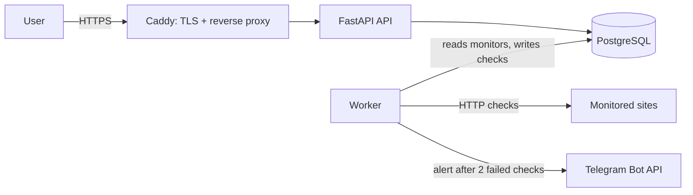

# Pulse


An uptime monitoring platform. Register a URL, and a background worker checks it on a schedule, records status and latency, and the API reports uptime stats. If a site goes down, you get a Telegram alert. Deployed on an Azure VM with HTTPS and fully automated CI/CD.

**Live demo:** https://pulse-sinchu.duckdns.org/docs

## Architecture



| Service | Role |
|---|---|
| **caddy** | Reverse proxy and the only public entry point; automatic HTTPS (Let's Encrypt) |
| **api** | FastAPI app: manage monitors, view checks and uptime stats, `/health` |
| **worker** | Background loop that checks due monitors, stores results and sends alerts |
| **db** | PostgreSQL 16 with a persistent volume; schema created from `db/init.sql` |

## CI/CD pipeline

Every push to `main` runs `.github/workflows/ci.yml`:

| Job | What it does |
|---|---|
| **secrets-scan** | Gitleaks scans the code and full Git history for leaked secrets |
| **unit-tests** | 13 pytest tests for API auth, input validation, status logic and alert logic |
| **image-scan** | Trivy scans both Docker images and fails on HIGH/CRITICAL vulnerabilities that have a fix |
| **build-and-test** | Builds the images from scratch, starts the full stack, adds a monitor, and checks the worker records a successful check |
| **publish** | Pushes the API and worker images to GitHub Container Registry (`ghcr.io`), tagged `latest` and with the commit SHA |
| **deploy** | Connects to the Azure VM over SSH, pulls the new images, and restarts the stack |

`publish` and `deploy` only run if every earlier job is green, so a broken or vulnerable build is never published or deployed. Pushes that only change `.md` files skip the pipeline.

## Alerts

The worker sends a Telegram message when a site fails 2 checks in a row, and another when it recovers. It sends one message per change, not one per check. Alerts are off unless `TELEGRAM_BOT_TOKEN` and `TELEGRAM_CHAT_ID` are set in `.env`.

**Limitation:** alert state is kept in memory, so a worker restart can send a repeat alert for a site that is still down.

## Deployment

- **Cloud:** Azure VM (Ubuntu 22.04) in a resource group, with a static public IP
- **Network:** Azure firewall (NSG) allows only ports 22, 80 and 443
- **Domain and HTTPS:** DuckDNS domain; Caddy obtains and renews a Let's Encrypt certificate automatically
- **Images:** the VM pulls prebuilt images from `ghcr.io` using `docker-compose.prod.yml` (nothing is built on the VM)
- **Config split:** `Caddyfile` (localhost, for development) and `Caddyfile.prod` (real domain, for the VM)

## Infrastructure as Code

`terraform/main.tf` builds the Azure setup from code: resource group, virtual network, static public IP, firewall (22/80/443) and an Ubuntu VM. A cloud-init script installs Docker and starts the full Pulse stack on first boot. I verified this on a fresh resource group: after one `terraform apply`, all four containers (db, api, worker, caddy) came up healthy with no manual steps, and then I ran `terraform destroy`.

```bash
cd terraform
# create terraform.tfvars with subscription_id and ssh_public_key
terraform init
terraform plan
terraform apply
terraform destroy
```

State and variable files are git-ignored on purpose. The live VM was built by hand with `az` commands, so it is not managed by Terraform.

## Run it locally

Requires Docker Desktop.

```bash
cp .env.example .env
docker compose up --build -d
docker compose ps
```

Then open https://localhost/docs (accept the local certificate warning) and add a monitor (see the API key note below):

```json
{"name": "Google", "url": "https://google.com", "interval_seconds": 30}
```

Watch the worker: `docker compose logs -f worker`

Run the tests (Python 3.12):

```bash
pip install pytest httpx -r api/requirements.txt -r worker/requirements.txt
python -m pytest -v
```

## API

| Method | Path | Auth | Description |
|---|---|---|---|
| GET | `/health` | none | Checks the API and database connection |
| POST | `/monitors` | `X-API-Key` header | Add a website to monitor |
| GET | `/monitors` | none | List monitors |
| GET | `/monitors/{id}/checks` | none | Recent results for one monitor |
| GET | `/status` | none | 24h uptime % and average latency per monitor |

Write endpoints require an `X-API-Key` header matching the `API_KEY` environment variable. Read endpoints are public so the status page can be shared.

## Design choices

- Secrets come from environment variables; `.env` is git-ignored, `.env.example` is the template with empty values.
- Containers run as a non-root user.
- API and worker wait for the database healthcheck before starting.
- The worker survives database outages and resumes on its own.
- Only Caddy exposes ports; the API and database sit on a private Docker network.
- Deploys use a dedicated SSH key stored as a GitHub secret, separate from my personal key.
- Images are tagged with the commit SHA so any version can be traced and rolled back.
- The worker's HTTP library logs are silenced at INFO level, because the Telegram request URL contains the bot token.

## Failure experiments and lessons

See [notes.md](notes.md) for what happens when the database is stopped, restarted, and deleted, plus the problems I hit while deploying and how I fixed them.

## Known limitations

- Single VM, no high availability.
- Alert state is in memory (see Alerts above).
- No dashboards or database backups yet.

## Roadmap

- [x] Phase 1: containerized app (Docker Compose)
- [x] Phase 2: CI pipeline with smoke test, images published to ghcr.io
- [x] Phase 3: deployed to Azure VM with a domain, HTTPS and automatic deploys
- [x] API key authentication for write endpoints
- [x] Infrastructure as Code (Terraform) with cloud-init
- [x] Automated tests (pytest) in CI
- [x] Security scanning: Gitleaks and Trivy
- [x] Telegram downtime alerts
- [ ] Database backups
- [ ] Monitoring dashboards (Prometheus, Grafana)
- [ ] Kubernetes